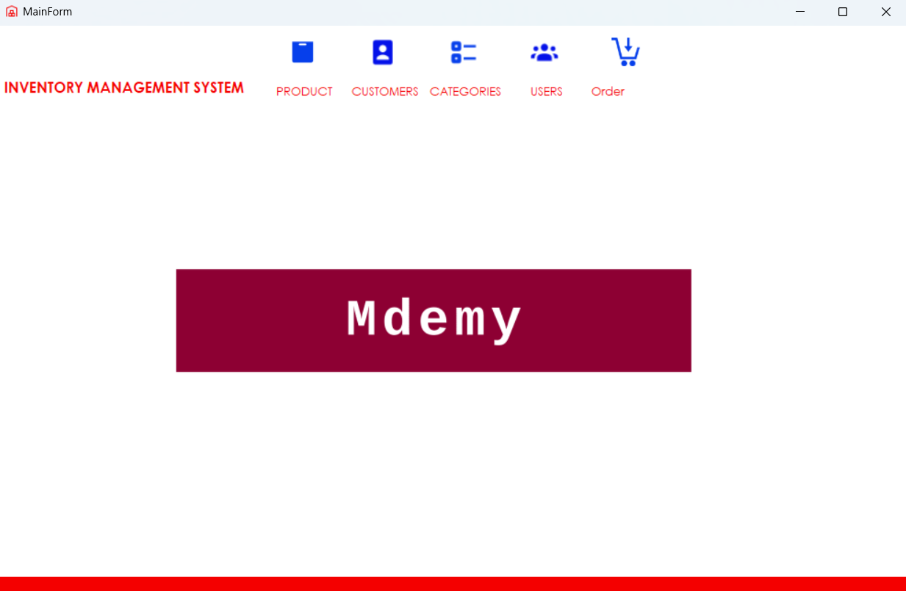
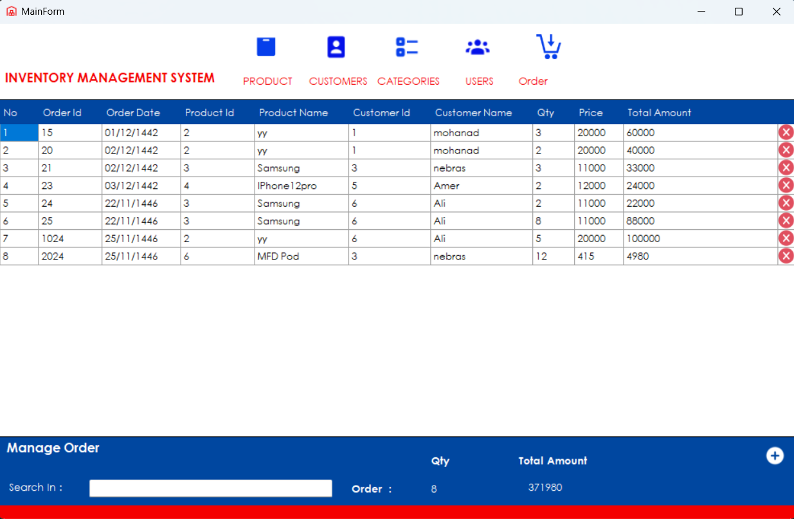

# Inventory Management System

An inventory management desktop application built with **C# and Windows Forms**, designed to handle various administrative tasks such as managing products, categories, customers, orders, and users efficiently.

---

## 🚀 Features

* User Authentication (Login System)
* Dashboard with Welcome Screen
* Manage Products (Add, Edit, Delete)
* Manage Categories
* Manage Customers
* Manage Orders
* Manage Users
* Responsive and user-friendly UI

---

## 📸 Screenshots

Screenshots of the application's interface are available in the `screenshots` folder.


📸 Main Form


📸 Order Form



---

## 🛠️ Installation

1. Clone this repository:

```bash
git clone https://github.com/your-username/InventoryManagementSystem.git
```

2. Open the solution file `InventoryManagementSystem.sln` using **Visual Studio**.
3. Restore NuGet packages if required.
4. Build the solution.

---

## ▶️ How to Run

1. Run the application from Visual Studio (Press `F5`).
2. The login form will appear.
3. Use demo credentials (if applicable) or create a new user.
4. Start managing your inventory!

---

## 💼 Technologies Used

* C#
* Windows Forms (WinForms)
* .NET Framework
* Visual Studio
* SQL Server (Assumed, from `Tutorial Database` folder)

---

## 📂 Project Structure

* `InventoryManagementSystem.sln` – Visual Studio solution file.
* `InventoryManagementSystem/` – Main source code.
* `Tutorial Database/` – Contains the sample database.
* `c# photoes/` – UI screenshots folder.


---

## 📌 Notes

* Ensure SQL Server is running and the connection string is properly configured.
* This project is for educational purposes and can be extended for production use.

---

Feel free to contribute, fork, or raise issues!

---

**© 2025 Inventory Management System**
